# Smart Filter

EspoCRM extension that improves the search and filter bar of list views.

## Features

Screenshots were taken on EspoCRM 10.0.3 with the English language (en_US).

- **Filter icon**: the ⋮ (three vertical dots) button to the right of the search bar, which opens the "Add Field" list, now shows a filter icon (`fa-filter`).

  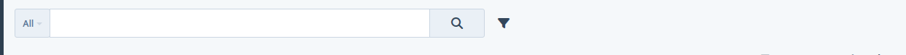

- **Active filter counter**: the badge on the filter button shows the number of active filter conditions. Each filled-in filter row, each checked boolean filter and the text search count as 1. The badge is hidden when no filter is active. Hovering the button shows the same explanation.

  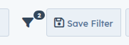

- **Menu stays open while selecting**: the "Add Field" menu stays open after adding a field, so you can add several in a row. The Enter key adds the first matching field and keeps the typed text.

  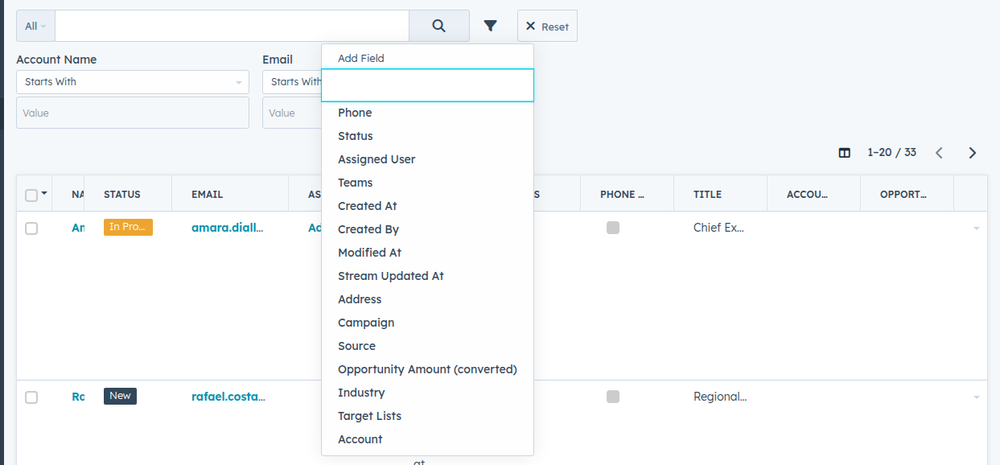

- **Field search**: the search box in the filter menu filters fields ignoring case and accents (for example, typing "mail" finds the email fields). Fields already added are excluded, and a "No Data" message appears when nothing matches.

  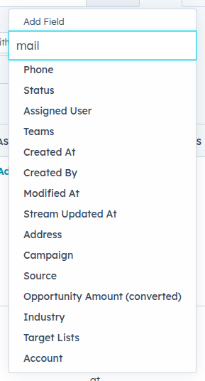

- **Frequently used fields first**: the fields you use most often appear at the top of the menu. These statistics are stored in the browser (localStorage), per entity and per user.

  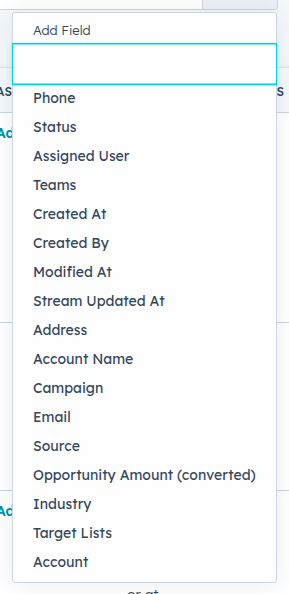

- **Automatic apply**: each change to a filter (value, operator, adding or removing a row, checkbox) runs the search immediately. There is no more "Apply" button to confirm.

  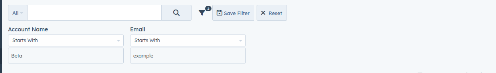

- **Empty filters ignored**: a filter row without a value is not saved. Previously saved presets and search state containing such a row no longer recreate it when opening the list, when selecting a preset, or when adding a new filter (for example, an "Account Name" row appearing for no reason).

  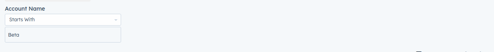

- **Reset button**: visible label, shown only when there is something to reset (a filter, a checked box, a changed sort, or a selected preset). Hidden otherwise. It also clears the checkboxes and returns to the default filter ("All").

  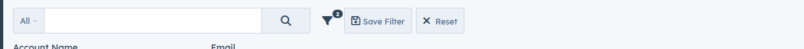

- **Save Filter button**: shown to the left of Reset as soon as a condition is filled in, including when a preset is selected, to save the current filter under a new name.

  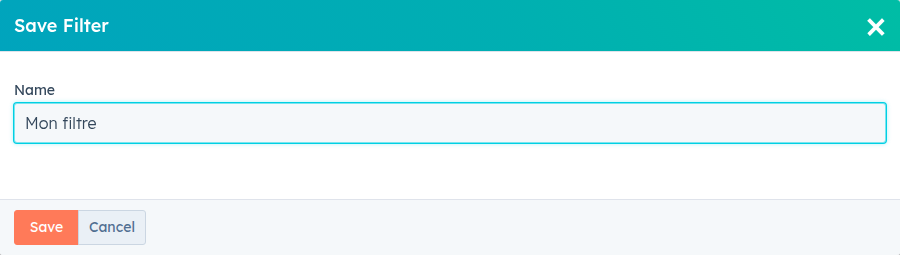

- **Preset summary**: when a saved preset is selected, its conditions are shown in readable form with their values (for example, "Created By: Is Admin", "Status: Any Of New", "Teams: Is Not Empty"). Empty rows are hidden.

  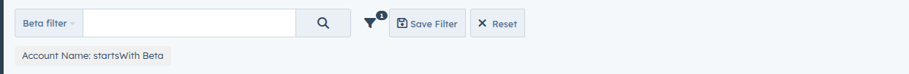

- **Editable presets**: a selected preset stays editable (adding, removing or changing values). As soon as the filter no longer matches the preset, the preset is deselected and a notice "Modified from saved filter « X »" appears above the filters. Going back to the original state (or selecting the preset again) restores the selection.

  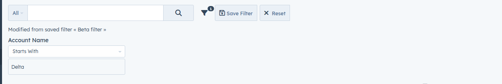

## Technical overview

- The `SmartFilter` module registers handlers through `clientDefs/Global.json` → `viewSetupHandlers` → `record/search`:
  - `smart-filter:handlers/record/search-filter-icon` replaces the `fa-ellipsis-v` class with `fa-filter`.
  - `smart-filter:handlers/record/search-filter-menu` handles the "Add Field" menu (opening, search, order, Enter key).
  - `smart-filter:handlers/record/search-filter-toolbar` handles the counter, the Reset button, the Save Filter button and the preset summary.
  - `smart-filter:handlers/record/search-filter-state` applies filters as soon as they change, removes empty entries from the search state (except rows still displayed, so they stay readable) and tracks the original preset to detect changes.
- Styles are in `css/smart-filter.css`, declared through `metadata/app/client.json` → `cssList`. The rule hiding filtered fields (`li.search-hidden`) is added there because some themes (including ModernTheme) do not provide it.
- Counter labels and its tooltip are in `i18n/<language>/SmartFilter.json` (`labels` category).
- No EspoCRM core file is modified: views are extended at runtime, which stays compatible with updates.

## Compatibility

- EspoCRM `>= 10.0.3 < 10.1.0` (tested on 10.0.3). The extension relies on the internal behavior of list views in this version, so the range is deliberately limited. Check compatibility before using it on another version.
- PHP `>= 8.3`

## Installation

1. Build the package: `npm run extension` (produces `build/smart-filter-1.0.0.zip`).
2. Install the ZIP from Administration → Extensions in EspoCRM.

## Development

- Sources are in `src/files/`.
- `npm run sync` copies the files into the `site` instance.
- `npm run clear-cache` clears the cache after a metadata change.

### Tests

The end-to-end tests use Playwright and run against a running instance (default `http://localhost:8080`):

```bash
ESPO_USERNAME=admin ESPO_PASSWORD=your-password npm test
```

Set `SMART_FILTER_CHROMIUM` to a Chromium executable if Playwright's bundled browser is not installed. Run `npx playwright install chromium` to install it.

## License

GPL-3.0-or-later. See [LICENSE](src/LICENSE).
